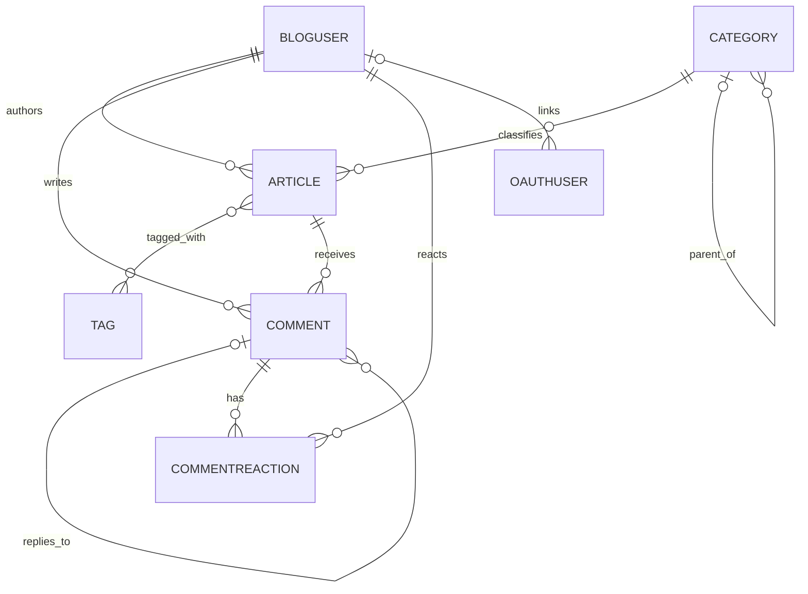

# 成员1｜数据库结构核对与导出说明

> 用途：作为绘制数据库结构图时的模型/关系核对清单，并记录如何从项目实际 MySQL 库导出 SQL 结构。
>
> **数据来源与限制**：核对对象为公开仓库 `EthanZF/6class8group` 的 `main` 分支模型、Django settings 与迁移文件。仓库配置的数据库地址是 `127.0.0.1:3306`，这是项目运行机器上的本地 MySQL；当前工作区没有该项目源码或该数据库连接，因此这里不能声称已连接数据库并生成真实 `mysqldump`。下面给出可在项目/数据库所在机器上直接执行的 schema-only 命令。真正的库表、列类型/长度、索引和约束请以命令生成的 SQL 为最终“标准答案”，再对照本清单和 ER 图。

## 1. 项目数据库基本信息

- Django 项目：DjangoBlog；仓库项目目录为 `src/`。
- 数据库引擎：MySQL（`django.db.backends.mysql`）。
- 数据库名：`djangoblog`；项目 settings 指向 `127.0.0.1:3306`。
- 自定义用户模型：`accounts.BlogUser`（继承 Django `AbstractUser`）。
- 默认主键类型：`BigAutoField`。
- Django 表名默认规则：`<app_label>_<model_name小写>`；外键删除规则以模型中的 `on_delete` 为准。

## 2. 获取真实库表结构（不导出业务数据）

在包含 `src/`、`doc/` 的仓库根目录执行。该命令会交互提示输入 MySQL 密码，不会把密码写进命令历史；`--no-data` 确保只导出结构，不导出用户、文章等数据。

```bash
cd src
python manage.py showmigrations
mysqldump --host=127.0.0.1 --port=3306 --user=root --password \
  --no-data --default-character-set=utf8mb4 --skip-comments \
  djangoblog > ../doc/djangoblog_schema.sql
```

执行后检查 `../doc/djangoblog_schema.sql`，并将其作为 ER 图校验依据。若要确认迁移计划，可在运行 `migrate` 前执行：

```bash
python manage.py migrate --plan
```

> 注意：`showmigrations` 中未勾选的迁移表示目标数据库可能还未达到当前代码的模型状态。先确认项目负责人允许，再决定是否迁移；不要为了导出结构擅自对生产库执行 `migrate`。`mysqldump` 需由有相应读取权限的数据库账号运行。若项目机器上的 MySQL 用户并非 `root`，替换 `--user` 即可。

## 3. 当前代码中的自定义数据模型清单

按当前模型代码共 **13 个自定义实体模型**：`blog` 6 个、`comments` 2 个、`accounts` 1 个、`oauth` 2 个、`servermanager` 2 个。`blog.BaseModel` 是抽象基类、`LinkShowType` 是枚举，不会各自生成数据库表。

| 应用 / 默认表名 | 模型 | 主要字段与用途 |
|---|---|---|
| `blog_article` | Article | BigAutoField 主键；继承 `creation_time`、`last_modify_time`；`title`（200，唯一）、`body`（Markdown 文本）、`pub_time`、`status`、`comment_status`、`type`、`views`、`article_order`、`show_toc`；外键 `author`→BlogUser、`category`→Category；多对多 `tags`→Tag。模型定义 4 个列表/热门/作者/分类查询索引。 |
| `blog_category` | Category | 主键、继承时间字段；`name`（30，唯一）、`parent_category`（可空自关联外键）、`slug`（60）、`index`。表达分类层级。 |
| `blog_tag` | Tag | 主键、继承时间字段；`name`（30，唯一）、`slug`（60）。 |
| `blog_links` | Links | `name`（30，唯一）、`link`（URL）、`sequence`（唯一排序值）、`is_enable`、`show_type`、创建/修改时间。 |
| `blog_sidebar` | SideBar | `name`（100）、`content`（文本）、`sequence`（唯一排序值）、`is_enable`、创建/修改时间。 |
| `blog_blogsettings` | BlogSettings | 站点名称/描述/SEO/关键词、文章摘要长度、侧栏/文章评论数量、广告开关及代码、评论开关、配色、全局头尾、备案/统计代码、公安备案开关与编号、评论审核开关。代码 `clean()` 仅做“单条配置”校验；数据库中未见对应唯一约束，不能把它画成数据库强制的一对一。 |
| `comments_comment` | Comment | `body`（文本，max_length=300）、创建/修改时间、`author`→BlogUser、`article`→Article、`parent_comment`（可空自关联外键）、`is_enable`；定义文章/父评论/启用状态及启用状态/ID 两个索引。 |
| `comments_commentreaction` | CommentReaction | `comment`→Comment、`user`→BlogUser、`reaction_type`（emoji 类型）、`created_at`；`comment + user + reaction_type` 唯一，另有 `comment + reaction_type` 索引。 |
| `accounts_bloguser` | BlogUser | 继承 Django `AbstractUser`（含 username、password、email、姓名、登录/启用/员工/超级用户状态、date_joined 等）；扩展 `nickname`、`creation_time`、`last_modify_time`、`source`。`groups` 和 `user_permissions` 是继承来的多对多。 |
| `oauth_oauthuser` | OAuthUser | `author`→BlogUser（可空）、`openid`（50）、`nickname`（50）、`token`（150，可空）、`picture`（350，可空）、`type`（50）、`email`（50，可空）、`metadata`（文本，可空）、创建/修改时间。 |
| `oauth_oauthconfig` | OAuthConfig | `type`（10，choices）、`appkey`/`appsecret`（各 200）、`callback_url`（200）、`is_enable`、创建/修改时间。`clean()` 检查 type 重复，但当前模型未声明数据库唯一约束。 |
| `servermanager_commands` | commands | `title`（300）、`command`（2000）、`describe`（300）、创建/修改时间；命令管理记录。 |
| `servermanager_emailsendlog` | EmailSendLog | `emailto`（300）、`title`（2000）、`content`（文本）、`send_result`、创建时间；邮件发送日志。 |

> `max_length` 是 Django 模型定义；数据库最终列类型、字符集、索引名称和迁移是否已应用，以真实 `mysqldump` 输出为准。Django/MySQL 具体版本也可能影响 DDL 呈现。

## 4. 关系清单（ER 图连线核对）



- `Article.author`、`Article.category`、`Comment.author`、`Comment.article`、`CommentReaction.comment/user` 为非空外键；删除关联对象时按代码 `CASCADE` 级联。
- `Category.parent_category`、`Comment.parent_comment` 可空；`OAuthUser.author` 可空。
- Article–Tag 是多对多，Django 自动生成中间表 `blog_article_tags`。
- BlogUser 从 AbstractUser 继承的两组多对多通常对应 `accounts_bloguser_groups`、`accounts_bloguser_user_permissions`；Django 权限系统另有 `auth_group_permissions`。
- 其余默认 Django 表还包括迁移、内容类型、权限、会话、站点、管理日志等；具体是否已建表取决于实际数据库迁移状态。

## 5. 与 OAuth 个人代码标注的核对点

具体字段解释见随附 `oauth_models_annotated.py`。ER 图只需画出 OAuthUser 到 BlogUser 的可空外键；OAuthConfig 是第三方登录提供方配置实体，不与其他业务模型建立外键。容易漏标的实现细节：

1. OAuthConfig `type` 的默认值是 `'a'`，但不在当前 choices（weibo/google/github/facebook/qq）中；数据库通常不会因 choices 自动限制取值。
2. OAuthConfig `clean()` 中的“type 不重复”是应用层校验，不等于数据库唯一索引；并发场景也无法单靠它保证唯一。
3. `last_modify_time` 使用 `default=now`，不是 `auto_now=True`，保存记录时不会自动刷新修改时间。
4. OAuthUser 的 `token`、`picture`、`email`、`metadata` 可空；`author` 可空且删除用户时级联删除关联 OAuth 记录。

## 6. 提交前格式检查清单

- [ ] 已在项目实际数据库所在机器运行 `mysqldump --no-data`，确认输出是当前库的真实结构，而不是从模型猜写的 SQL。
- [ ] `showmigrations` / `migrate --plan` 已核实迁移状态；文档注明数据库名、导出日期、代码分支或 commit。
- [ ] ER 图涵盖 13 个自定义模型、3 个自动多对多连接表（Article–Tag、BlogUser–Group、BlogUser–Permission）及 Django 必要表；抽象类和枚举不画成表。
- [ ] 外键方向、可空性、唯一约束、自关联、删除规则与模型/DDL一致；区分“代码校验”与“数据库约束”。
- [ ] 图有标题、图例（主键/外键/可空/唯一），字段名称大小写与项目一致；连线不交叉或歧义。
- [ ] 文档标题层级连续（一级标题用于文档名，二级标题用于章节，三级标题仅在需要时使用），表格和代码块排版无溢出。
- [ ] 导出文件只含结构，不包含业务数据、口令、token 或其他密钥；不要把数据库密码写入文档或提交记录。

## 来源

- 项目仓库：<https://github.com/EthanZF/6class8group>
- 核心定义：`src/djangoblog/settings.py`、各应用 `models.py` 与 `migrations/`。
