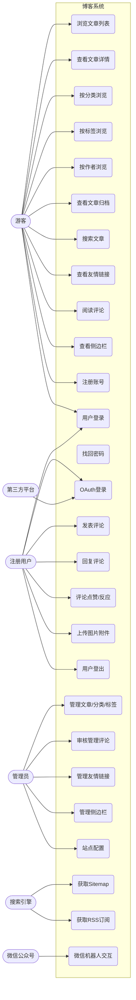
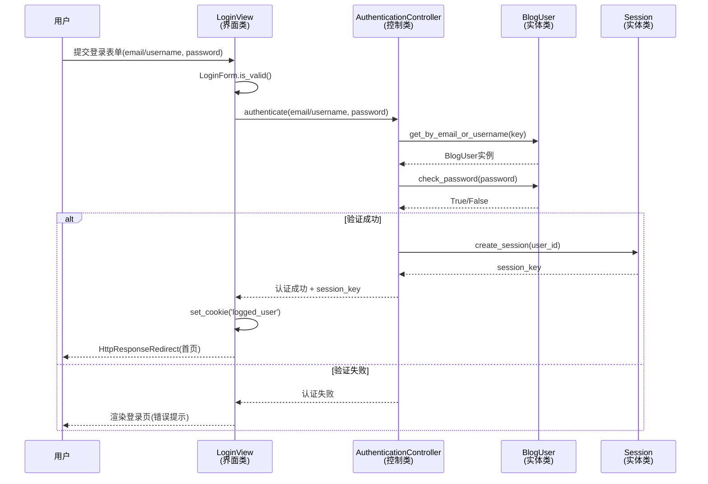
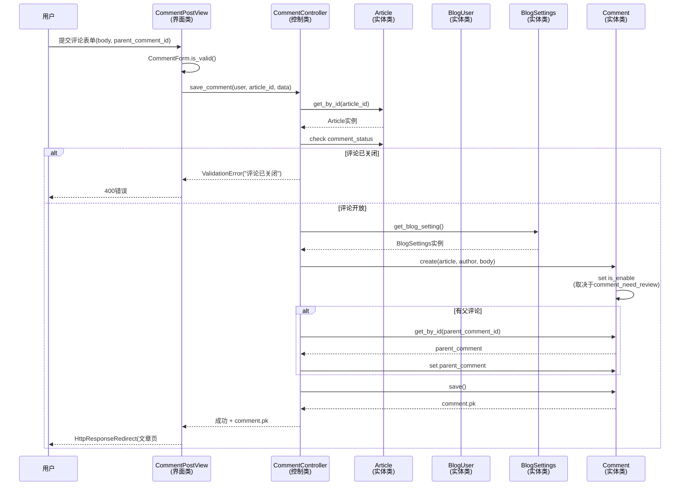

# DjangoBlog 用例图与说明

## 一、参与者（Actor）

| 参与者 | 说明 |
|---|---|
| 游客 | 未登录的匿名访客 |
| 注册用户 | 已登录的普通用户（博主/读者） |
| 管理员 | 站点维护者，通过后台管理内容 |
| 搜索引擎 | 抓取站点地图/RSS 的爬虫 |
| 微信公众号 | 通过机器人交互的外部平台 |
| 第三方平台 | 提供 OAuth 登录的外部服务 |

## 二、用例图

## 三、用例说明

### 1. 浏览文章列表（UC1）
- **参与者**：游客
- **入口**：`/`、`/page/<n>/`
- **说明**：分页展示已发布文章的标题、摘要、发布时间、作者、分类与浏览量；按 `article_order`、`pub_time` 降序排列。
- **后置**：游客可点击进入文章详情。

### 2. 查看文章详情（UC2）
- **参与者**：游客
- **入口**：`/article/<年>/<月>/<日>/<id>.html`
- **说明**：展示正文（Markdown 渲染、代码高亮）、目录、上一篇/下一篇、所属分类、标签、评论列表及侧边栏。
- **后置**：`views` 计数 +1；触发搜索索引实时更新。

### 3. 按分类浏览（UC3）/ 4. 按标签浏览（UC4）/ 5. 按作者浏览（UC5）
- **参与者**：游客
- **入口**：`/category/<slug>.html`、`/tag/<slug>.html`、`/author/<name>.html`
- **说明**：按分类树、标签云或作者维度筛选文章列表，支持分页。

### 6. 查看文章归档（UC6）
- **参与者**：游客
- **入口**：`/archives.html`
- **说明**：按时间线归档展示全部已发布文章，页面缓存 1 小时。

### 7. 搜索文章（UC7）
- **参与者**：游客
- **入口**：`/search`
- **说明**：基于 Haystack 全文检索，后端二选一（默认 Whoosh，设 `DJANGO_ELASTICSEARCH_HOST` 切 Elasticsearch），支持关键词高亮。

### 8. 查看友情链接（UC8）
- **参与者**：游客
- **入口**：`/links.html`
- **说明**：展示已启用的友情链接，按 `sequence` 排序。

### 9. 阅读评论（UC9）/ 10. 查看侧边栏（UC10）
- **参与者**：游客
- **入口**：文章详情页
- **说明**：展示已审核评论（支持无限嵌套）；侧边栏由最新文章、热门文章、最新评论、分类、标签云及自定义 `SideBar` 模块组成，缓存 3 小时。

### 11. 注册账号（UC11）
- **参与者**：游客
- **入口**：`/register/`
- **说明**：填写用户名/邮箱/密码，创建未激活用户，发送验证邮件；点击邮件链接激活账号。

### 12. 用户登录（UC12）
- **参与者**：游客 / 注册用户
- **入口**：`/login/`
- **说明**：邮箱或用户名 + 密码登录，支持“记住我”延长会话，登录后清除侧边栏缓存并设置 `logged_user` Cookie。

### 13. 找回密码（UC13）
- **参与者**：游客
- **入口**：`/forget_password/`、`/forget_password_code/`
- **说明**：通过邮箱验证码重置密码。

### 14. OAuth 登录（UC14）
- **参与者**：注册用户、第三方平台
- **入口**：`/oauth/oauthlogin` → `/oauth/authorize`
- **说明**：支持 Google、GitHub、Facebook、微博、QQ 等第三方登录；首次登录需补充邮箱并激活。

### 15. 发表评论（UC15）/ 16. 回复评论（UC16）
- **参与者**：注册用户
- **入口**：`/article/<id>/postcomment`
- **说明**：登录后提交评论正文；若文章评论关闭则拒绝。评论默认 `is_enable=False`，由 `BlogSettings.comment_need_review` 决定是否自动通过；可指定 `parent_comment` 实现嵌套回复。

### 17. 评论点赞/反应（UC17）
- **参与者**：注册用户
- **入口**：`/comment/<id>/react`（GET 获取 / POST 切换）
- **说明**：对已启用评论添加或取消 Emoji 反应，同一用户对同一评论同一 Emoji 唯一。

### 18. 上传图片附件（UC18）
- **参与者**：注册用户
- **入口**：`/upload`
- **说明**：为文章编辑器上传图片，返回 URL 供 Markdown 引用。

### 19. 用户登出（UC19）
- **参与者**：注册用户
- **入口**：`/logout/`
- **说明**：销毁会话，删除 `logged_user` Cookie，清除侧边栏缓存，跳转登录页。

### 20. 管理文章/分类/标签（UC20）/ 21. 审核管理评论（UC21）/ 22. 管理友情链接（UC22）/ 23. 管理侧边栏（UC23）/ 24. 站点配置（UC24）
- **参与者**：管理员
- **入口**：`/admin/`
- **说明**：后台管理文章、分类、标签、评论审核、友情链接、侧边栏自定义内容，以及站点名称/描述/SEO、配色方案、评论开关等单例配置。

### 25. 获取 Sitemap（UC25）/ 26. 获取 RSS 订阅（UC26）
- **参与者**：搜索引擎
- **入口**：`/sitemap.xml`、`/feed/`、`/rss/`
- **说明**：输出文章、分类、标签、作者、静态页面的站点地图与 RSS Feed，供收录与订阅。

### 27. 微信机器人交互（UC27）
- **参与者**：微信公众号
- **入口**：`/robot`
- **说明**：基于 WeRoBot 处理微信公众号消息，提供自动回复与菜单交互。

## 四、核心用例顺序图

### 用例一：用户登录

- **界面类**：`LoginView`
- **控制类**：`AuthenticationController`
- **实体类**：`BlogUser`、`Session`

### 用例二：发表评论

- **界面类**：`CommentPostView`
- **控制类**：`CommentController`
- **实体类**：`Comment`、`Article`、`BlogUser`、`BlogSettings`

